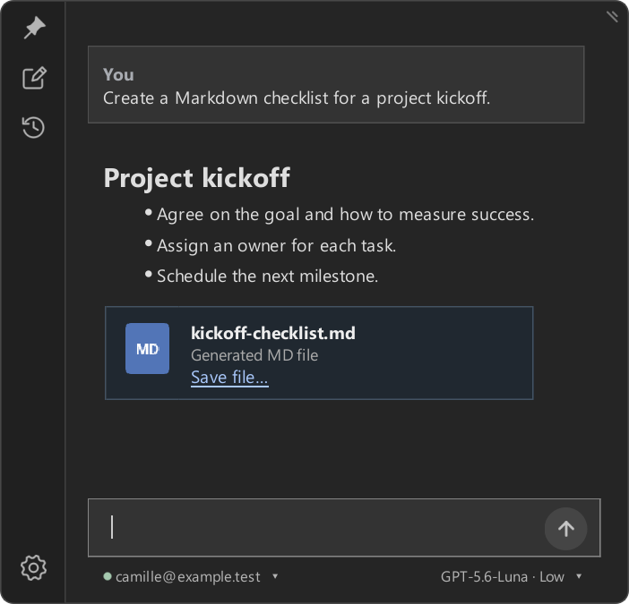

# ChatGPT Systray Companion

Windows tray client for the standalone Codex app-server. Built with Python and PySide6, using JSON-RPC over stdio.

[Windows releases](https://github.com/nicklausFR/chatgpt-systray-companion/releases) · [Codex CLI setup](https://learn.chatgpt.com/docs/cli)

## Screenshots

<table>
  <tr><th>Dark</th><th>Light</th></tr>
  <tr>
    <td></td>
    <td></td>
  </tr>
</table>

## Runtime

- Markdown chat with image previews and image, PDF, DOCX, and text attachments.
- Local JSON history with streamed response checkpoints and archived files. Restoring a chat seeds a new Codex thread with the saved context.
- Per-chat workspace with `inputs/` for originals and `exports/` for generated files. Codex turns use `workspace-write`.
- Account, model, and reasoning controls below the composer. The account menu reads remaining quotas and reset times via `account/rateLimits/read`.
- **Send to Codex** opens a desktop chat draft with a reference to the local transcript and files.

## Run from source

Requires Python 3.11 and a standalone Codex CLI. Companion reuses the CLI authentication.

```powershell
python -m pip install -r requirements.txt
python app.py --show
```

## Build

```powershell
python -m pip install -r requirements-build.txt
python build_exe.py
```

Output `dist/chatgpt-systray-companion.exe`.

## Checks

```powershell
python -m unittest discover -s tests -v
python app.py --smoke-test --report diagnostic.json
python translations/build_catalogs.py --check
```

## License

[GPL-3.0](LICENSE)
