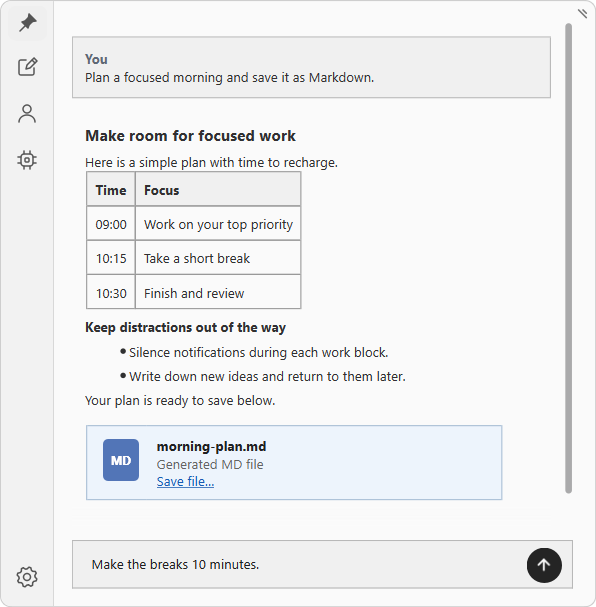

# ChatGPT Systray Companion

A compact Windows chat companion powered by Codex, available directly from your system tray.

Ask a quick question, attach a document or image, and read formatted Markdown responses in a small, adjustable window.

Download the Windows executable from [GitHub Releases](https://github.com/nicklausFR/chatgpt-systray-companion/releases/latest).

## Screenshots

An example conversation with Markdown formatting and a generated file, using the English interface.

<table>
  <tr>
    <th>Dark</th>
    <th>Light</th>
  </tr>
  <tr>
    <td></td>
    <td></td>
  </tr>
</table>

## Features

- System tray access, with no additional taskbar icon.
- Automatic hiding when you click outside the window; pin it to keep it open and always on top.
- Compact interface with light, dark and automatic Windows appearance, plus a single-line input that grows up to five lines.
- French and English interface, with changes applied immediately and remembered between launches.
- Rectangular frames for the current question and previously sent questions.
- Automatic window growth as the conversation expands.
- Markdown rendering, including headings, lists, tables, links and code blocks.
- Copy each response as raw Markdown using its hover button or right-click menu.
- Generate files, archives or complete folders, then save them through a Windows dialog.
- Images fit the available response width; click to open the original resolution.
- Document and image attachments through drag and drop, clipboard paste or the context menu.
- Model and reasoning-level selection, with preferences remembered between launches.
- Persistent custom instructions, editable in Options and applied from the next message.
- Integrated send and stop buttons.
- Subtle scroll indicators and edge fades.
- Startup checks for Codex availability and connectivity.

Responses appear once generation finishes, allowing Markdown to be displayed fully formatted. Generation can be interrupted.

## Language and appearance

Open the gear menu at the bottom of the sidebar to change these settings:

| Setting | Available choices | Menu |
|---|---|---|
| Interface language | French (`fr`) and English (`en`) | **Options → Language → Français / English** |
| Appearance | Light, Dark and Automatic (Windows) | **Options → Appearance** |

On first launch, the interface uses French on a French system and English
otherwise. Appearance follows the Windows app theme by default. Automatic mode
also follows Windows theme changes while the companion is running.

Both preferences are saved locally and apply immediately, preserving the current
conversation, draft and any response in progress. Interface language does not
impose a language on your messages or the assistant's replies. Native Windows
file dialogs use the Windows display language for their system controls.

## Requirements

For the Windows executable:

- Windows x64.
- A compatible standalone Codex CLI installation.
- A Codex sign-in with access to the models you want to use.
- An internet connection.

Python and Qt are included in the executable.

## Getting started

1. Run `chatgpt-systray-companion.exe`.
2. The application checks your local Codex installation and sign-in.
3. Click the system tray icon to open the chat window.

If Codex is missing or cannot start, a setup screen lets you:

- Open the official installation or update instructions.
- Select an existing `codex.exe`.
- Retry the checks.
- Run automatic detection again.

If sign-in is required, use the account menu to sign in with ChatGPT through the official browser flow.

Codex installation and updates are performed separately. The application does not automatically download or run an installer.
Automatic detection prefers the standalone CLI over the engine bundled with the
Codex desktop application, which depends on services of that application.

[Official Codex setup instructions](https://learn.chatgpt.com/docs/cli)

## Usage

| Action | How |
|---|---|
| Show or hide the window | Click the system tray icon |
| Send a message | Press **Enter** or click the arrow |
| Insert a line break | Press **Shift + Enter** |
| Stop a response | Click the stop button |
| Copy a response as Markdown | Hover over its footer and click the overlapping-sheets icon, or right-click the response |
| Save a generated file or folder | Click **Enregistrer** on its card and choose a destination |
| Save any response as Markdown | Right-click the response and choose **Enregistrer la réponse…** |
| Attach a file | Drag and drop, paste, or right-click |
| Change model and reasoning | Use the model icon in the left sidebar |
| Set recurring instructions | Open the gear menu and choose **Instructions…** |
| Change interface language | Open **Options → Langue / Language**, then choose **Français** or **English** |
| Change appearance | Open **Options → Apparence / Appearance**, then choose **Clair / Light**, **Sombre / Dark**, or **Automatique / Automatic (Windows)** |
| Start a new conversation | Click the square-and-pencil icon below the pin, or use the system tray context menu |
| Keep the window open and on top | Click the pin icon in the left sidebar |
| Hide the window | Click outside while unpinned, press **Esc**, or click the tray icon |
| Exit the application | Choose **Quitter** from the system tray menu |

The window returns to the system tray when it loses focus, unless pinned. Menus,
file dialogs and image previews remain usable. Hiding the window preserves the
current conversation and any response in progress while the application is running.

Options lets you save recurring instructions such as preferred language, tone or
response length. Changes apply to subsequent messages in the current conversation
without resetting it. Choose **Instructions…** in the Options menu to edit them;
clear the field to remove these preferences. The field is empty by default and
saved locally. There is no built-in prompt prohibition on using tools
or inspecting local files. Codex can create deliverables in a temporary workspace; actions
requiring approval are not supported by this client.

## Attachments

Supported inputs include:

- Images.
- PDF documents, including scanned pages.
- DOCX documents.
- Plain text, Markdown, CSV, JSON and other text-based files.

Attachments appear as cards before sending and remain visible in the conversation afterward.

Documents are processed locally, then their extracted text and/or images are sent through Codex for analysis.

## Generated files

Ask for a file, archive, or folder containing several files. For example:

> Create a folder called website with index.html, assets/style.css and script.js.

The response displays a file card with an **Enregistrer** action. For a single file,
choose its name and location in the Windows Save As dialog. For a folder, choose
the parent directory; the application creates the folder and its subfolders there.
An existing folder is preserved and a numbered name is used for the new one.

Codex creates actual files in a temporary workspace using its available tools.
The application detects completed deliverables and copies their bytes unchanged;
it does not impose a whitelist of file formats. A ZIP is an actual archive and can
contain binary or text files. Generation depends on the tools available to Codex
on the user's computer.

Files remain temporary until you choose a destination. Cancelling the save dialog
does not write to your chosen folder. Temporary workspaces are removed when the
application exits; saved copies remain. You can also save a normal response as a
Markdown file from its right-click menu.

Attached originals are made available in the conversation workspace so they can
be reused unchanged in generated files and archives.

## Account and usage

The application uses the local Codex engine and its authentication.

Each user signs in with their own account and uses their own available models and usage limits. No API key is required when signing in with ChatGPT.

## Run from source

Use Python 3.11 and run these commands from the repository directory:

```powershell
python -m pip install -r requirements.txt
python app.py
```

To show the window immediately:

```powershell
python app.py --show
```

## Build the Windows executable

Run on Windows:

```powershell
python -m pip install -r requirements-build.txt
python build_exe.py
```

The executable is created at:

```text
dist/chatgpt-systray-companion.exe
```

## Tests and diagnostics

Run the automated tests:

```powershell
python -m unittest discover -s tests -v
```

Check Codex connectivity without opening the chat window:

```powershell
python app.py --smoke-test --report diagnostic.json
```

The Windows executable supports the same diagnostic options.

## Translations

Application text uses Qt `QTranslator` and the Qt Linguist catalog
`translations/companion_en.ts`; French is the source language. Qt's French
translation also localizes standard widget actions such as Undo and Copy.

After adding `tr("French source text")` in the source, run
`python translations/build_catalogs.py --update` to add missing entries. Fill any
unfinished translations using Qt Linguist, then run
`python translations/build_catalogs.py` to validate placeholders and compile the
`.qm` catalog with Qt `lrelease`. The Windows build recompiles and bundles these
catalogs automatically. To validate without compiling, use `--check`.

## Current limitations

- Conversations are temporary. Starting a new chat or quitting the application clears the current conversation.
- Persistent history and direct handoff to the Codex desktop application are not implemented yet.
- Standard text selection copies rendered content; use the response copy action to preserve Markdown syntax.

## Planned improvements

- Persistent local conversation history.
- Continue a conversation in Codex.

## License

GNU General Public License v3.0. See [LICENSE](LICENSE).
